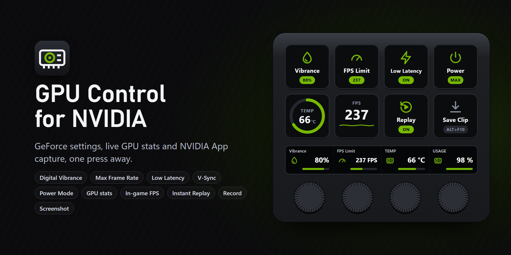
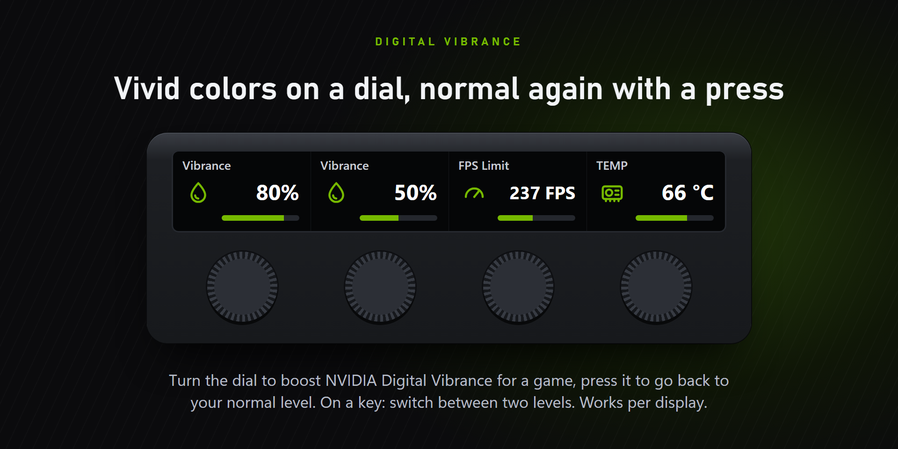
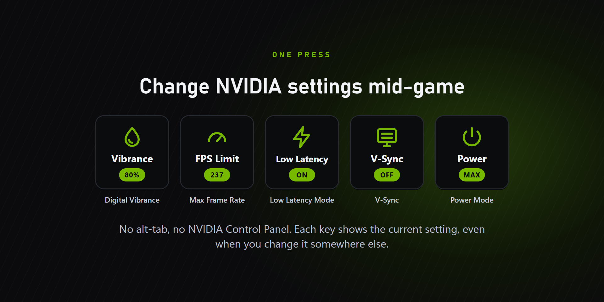
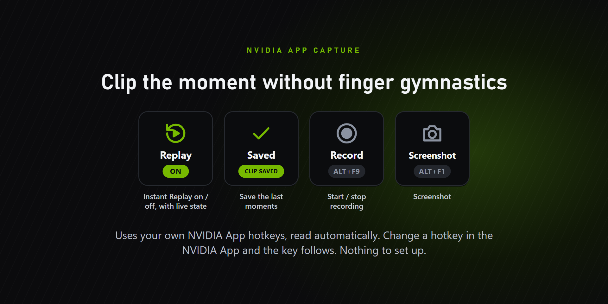
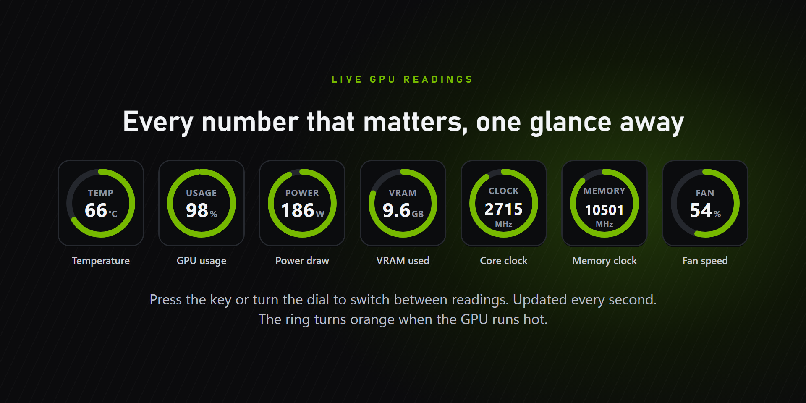
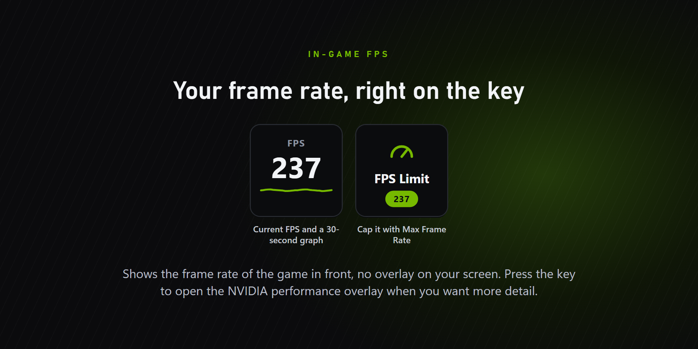

# GPU Control for NVIDIA for Stream Deck

Change NVIDIA GeForce settings mid-game from your Stream Deck: Digital Vibrance, Max Frame Rate, Low Latency Mode, V-Sync and Power Mode. Keep an eye on your GPU with live temperature, usage, power, VRAM, clock and fan readings and in-game FPS, and control NVIDIA App Instant Replay, recording and screenshots with one press.

Works on every Stream Deck model with keys. On a Stream Deck +, you can also use the dials and the touch strip. No administrator rights needed.

## Digital Vibrance
Changes NVIDIA Digital Vibrance (color saturation) of a display.
- **Dial:** rotate to adjust, press or tap to go back to your normal level
- **Key:** switch between the key level (for example 80%) and your normal level (NVIDIA's default is 50%)

Choose the display in the settings. Every display has its own level.

## Switches
Max Frame Rate, Low Latency Mode, V-Sync and Power Mode change the NVIDIA **global** settings, the same ones as *NVIDIA Control Panel › Manage 3D settings › Global Settings*. Each key shows the current setting, also when you change it somewhere else.

- **Max Frame Rate:** toggle, turn on or turn off the frame rate limit. On a dial, rotate to change the limit and press to switch it on or off. The key remembers the last limit you used; the first time it suggests your refresh rate minus 3 (keeps G-SYNC active).
- **Low Latency Mode:** toggle, turn on or turn off.
- **V-Sync:** cycle App → Off → On, or always set one value (use the game's setting, force off, force on, Fast Sync).
- **Power Mode:** toggle between Normal and Prefer maximum performance, or always set one of them.

Some games pick up a change only after a restart. Games with NVIDIA Reflex use Reflex instead of Low Latency Mode.

## Instant Replay, Save Clip, Record and Screenshot
- **Instant Replay:** turns NVIDIA Instant Replay on or off and shows *ON* / *OFF* live.
- **Save Clip:** saves the last moments recorded by Instant Replay and confirms with *Saved*.
- **Record:** starts or stops a recording.
- **Screenshot:** takes a screenshot.

These keys press **your own NVIDIA App hotkeys**, read automatically from the NVIDIA App, so there is nothing to set up. The key shows the hotkey it uses. If you change a hotkey in the NVIDIA App, the key follows. Clips and screenshots are saved where the NVIDIA App saves them.

If the NVIDIA App in-game overlay is turned off, the keys show *OVERLAY OFF*. Turn it on in *NVIDIA App › Settings › Features › NVIDIA Overlay*.

## GPU Status
Shows one GPU reading on a key or on a dial:
- Temperature and GPU usage
- Power draw and VRAM used
- Core clock, memory clock and fan speed

**Key:** press to show the next reading (or set it to do nothing). **Dial:** rotate or press to switch readings.
The ring turns orange above 83 °C. Readings your GPU doesn't report are marked *not available* and skipped.

## FPS
Shows the frame rate of the game in front with a graph of the last 30 seconds, without an overlay on your screen. Shows *no game* when no game is in front. Press the key to open the NVIDIA performance overlay (or set it to do nothing).

**One-time permission:** Windows only lets apps read game frame rates after a one-time permission (Xbox Game Bar asks for the same). If the key shows *setup*, open its settings and click **Allow FPS reading**, then confirm the Windows prompt. If the FPS still doesn't show, sign out of Windows and back in once.

If MSI Afterburner / RivaTuner Statistics Server is running, the FPS is read from there and no permission is needed.

## Setup
1. Install a recent NVIDIA driver. For the capture keys, install the **NVIDIA App** and keep its in-game overlay turned on.
2. Drag the actions you want onto keys or dials.
3. For FPS: click **Allow FPS reading** in the FPS key's settings once.

The top of every settings panel shows which GPU and driver the plugin found. A key showing **N/A** means your GPU, driver or display doesn't offer that feature. A key showing **NO NVIDIA GPU** means the plugin couldn't find an NVIDIA GPU or driver: install or update the driver and click **Refresh**.

## Requirements
- Windows 10 / 11, Stream Deck 6.9 or later
- An NVIDIA GeForce graphics card with a recent NVIDIA driver
- NVIDIA App with the in-game overlay for Instant Replay, Save Clip, Record and Screenshot
- Some readings depend on the card and driver. For example, a few cards don't report power draw.

Settings are changed through NVIDIA's official driver interfaces, the same ones the NVIDIA Control Panel uses. No data leaves your computer.

## Release notes

### 1.0.0
- First release: Digital Vibrance on dials and keys for each display; Max Frame Rate on keys and dials; Low Latency Mode, V-Sync and Power Mode keys; Instant Replay (with live state), Save Clip, Record and Screenshot using your NVIDIA App hotkeys; GPU Status (temperature, usage, power, VRAM, core clock, memory clock, fan) on keys and dials; in-game FPS with a graph.

## Support
Open an issue on this page.

## License
Copyright © 2026 NiQzen. All rights reserved. Use of the plugin is governed by the end user license agreement in [LICENSE](LICENSE). The plugin includes NVIDIA NVAPI under the MIT License (see THIRD-PARTY-NOTICES.txt in the plugin folder).

NVIDIA, GeForce, G-SYNC and NVIDIA Reflex are trademarks of NVIDIA Corporation. This plugin is not affiliated with, sponsored or endorsed by NVIDIA. Stream Deck and Elgato are trademarks of Corsair Memory, Inc.
